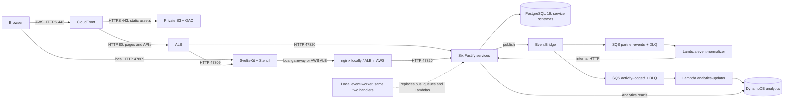
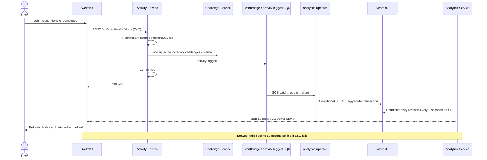
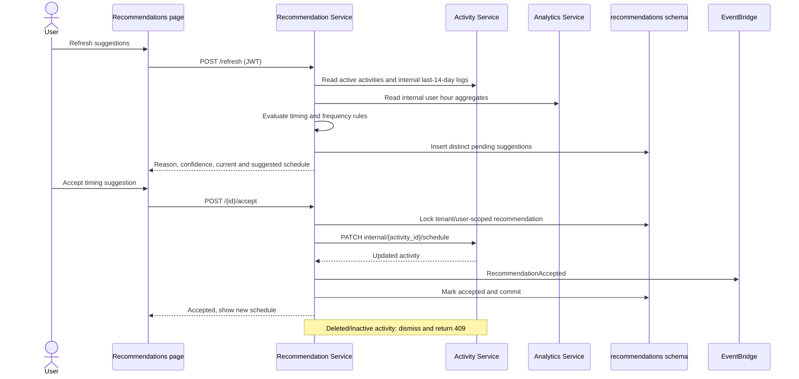

# HabitLoop

HabitLoop is a multi-tenant habit tracker and community challenge platform for NAGP Case Study 3.
Users schedule activities, record progress, join challenges, import signed mock wearable workouts,
and accept explainable schedule recommendations. Six Node.js 22 services use TypeScript, Fastify 5,
Drizzle ORM over `pg` and TypeBox schemas, tested with Vitest. The frontend uses SvelteKit 2, Svelte 5
runes, and Stencil web components. Python appears only in the seed, smoke, simulator and
deployment helper scripts.

Start with the [local setup](docs/setup.md), then follow the [user walkthrough](docs/walkthrough.md).
AWS deployment and evidence capture are described in the [deployment guide](docs/deployment/README.md).
These documents describe the implementation; AWS screenshots and the recording are owner-produced
deliverables, not evidence that a deployment has already occurred.

## System architecture



The [network diagram](docs/diagrams/network-architecture.md) and editable
[draw.io file](docs/diagrams/network-architecture.drawio) show subnets, ports, and AWS boundaries.
Locally, Compose binds only web `47809` and gateway `47810` to loopback. Backend containers use
`47820`; databases stay on the private Compose network. Persistent local data lives under `data/`.
In AWS there are seven ECS services: the six APIs plus the SvelteKit Node server. S3 holds static
assets, while the server handles pages and form actions. Cloud Map supplies private backend DNS.

## Six services

Endpoint paths below are relative to the shown prefix. Each service also has prefixed `/health`,
`/docs`, and `/openapi.json`. Internal routes require `X-Internal-Token`, often with a user JWT,
and cannot be reached through nginx or the ALB.

| Service and prefix | Responsibility | Data store | Events in / out | Key endpoints |
|---|---|---|---|---|
| User, `/api/users` | Tenant registration, login, profile and timezone | PostgreSQL `users` | None / none | `POST /register`, `POST /login`, `GET/PATCH /me`, `GET /tenants/{slug}` |
| Activity, `/api/activities` | Activity schedules, manual logs and partner log deduplication | PostgreSQL `activities` | Normalizer calls internal HTTP / `ActivityLogged` | `GET/POST` prefix, `GET /today`, `GET/PATCH/DELETE /{id}`, `GET/POST /{id}/logs`, internal log and schedule routes |
| Challenge, `/api/challenges` | Tenant challenge feed, visibility, participation and invitations | PostgreSQL `challenges` | None / none | `POST` prefix, `GET /feed`, `GET /invites`, `GET /{id}`, `POST /{id}/join`, `POST /join-by-code`, `POST /{id}/invites`, invite accept/decline and leave |
| Integration, `/api/integrations` | Provider mapping, per-link key, raw workout storage and ingest | PostgreSQL `integrations` | Normalizer updates event state over internal HTTP / `PartnerEventReceived` | `GET /providers`, `GET/POST /links`, `DELETE /links/{id}`, `GET /links/{id}/events`, `POST /ingest/{link_id}` |
| Analytics, `/api/analytics` | Read aggregates, progress, streaks, milestones and live summary | DynamoDB; no relational tables | `ActivityLogged` handled by analytics-updater Lambda / none | `GET /summary`, `/trend`, `/heatmap`, `/milestones`, `/cohorts`, `/challenges/{id}/progress`, `/stream`; internal user hours |
| Recommendation, `/api/recommendations` | Compute and persist timing/frequency suggestions; accept or dismiss | PostgreSQL `recommendations`; reads Activity and Analytics APIs | No subscription / `RecommendationAccepted` | `GET` prefix, `POST /refresh`, `POST /{id}/accept`, `POST /{id}/dismiss` |

`RecommendationAccepted` is published but has no downstream EventBridge consumer in this build.
Shared auth, database helpers, event publishing, analytics keys and logging live once in
`services/shared/node` as the npm workspace package `@habitloop/shared`.

## Manual log to dashboard



In local mode, publishing calls `event-worker` synchronously and it runs the same handler.
AWS aggregation is asynchronous, so the accepted log may precede the displayed aggregate.

## Wearable to activity log

```mermaid
sequenceDiagram
    participant Sim as Wearable simulator
    participant Integration as Integration Service
    participant PG as PostgreSQL
    participant EB as EventBridge
    participant SQS as partner-events SQS
    participant L as event-normalizer Lambda
    participant Activity as Activity Service
    Sim->>Integration: POST ingest/{link_id}, HMAC-SHA256 body
    Integration->>Integration: Check active link and signature
    Integration->>PG: Commit raw event, unique (link_id, event_id)
    Integration->>EB: PartnerEventReceived
    Integration-->>Sim: 202 received (200 duplicate on replay)
    EB->>SQS: Match source habitloop.integration and detail-type
    SQS->>L: Invoke, batch size 1
    L->>Integration: Read current link mapping (tenant JWT + internal token)
    alt Unmapped or invalid activity
        L->>Integration: Mark rejected with reason
    else Valid workout
        L->>Activity: POST internal/logs, source_event_id = partner-event row ID
        Activity->>Activity: Persist once and emit ActivityLogged
        Activity-->>L: 201 log or 200 duplicate
        L->>Integration: Mark normalized
    end
    Note over SQS,L: Transient failures retry; after 3 receives move to DLQ
```

The mock providers are `mockfit` and `mockrun`, not real OAuth integrations. A workout becomes
`completed` at duration >=20 minutes or steps >=5000, otherwise `done`. Unmapped workouts are
retained as `rejected` and visible in Recent events.

## Recommendation Service

Refresh is explicit through `POST /api/recommendations/refresh`. Inputs are the user's active
activities, user-wide hour aggregates from Analytics, and that user's Activity logs from the
last 14 days. All reads carry the tenant identity. This is deterministic scoring, with no ML
model, external inference API, or scheduled compute job.

| Rule | Evidence and output |
|---|---|
| Timing | Current and candidate hour each need at least 3 attempts. Choose the highest success rate, then most attempts, then earliest hour. Suggest the best hour if it differs from the current hour and improves success rate by at least 15 percentage points. Suggested minutes are `00`. |
| Frequency | For a daily activity with at least 3 logs in the last 14 days, count full `completed` logs. If fewer than 7, propose `max(3, completed_count // 2)` per week only if lower than the existing target. It changes `target_per_week`, not the `frequency` enum. |
| Confidence | Low below 10 attempts, medium from 10 through 29, high at 30 or more. Timing uses the smaller of the two hour-window sample counts; frequency uses log count. |

Timing successes include both `done` and `completed`. Hour evidence spans the stored history
and all the user's activities, while frequency uses the last 14 days for one activity.
Insufficient evidence can return `needs at least 3 logs per time window`; sufficient evidence
does not guarantee a suggestion. Identical pending suggestions are deduplicated, including
concurrent refreshes. Accepted and dismissed history remains available.



Repeated acceptance returns the accepted row without updating again. A dismissed suggestion
returns 409 on accept. Activity 404/409 becomes `Activity no longer applies`; the page displays
`No longer applies`. Upstream read failures return 503, and accept transport/publish failures
return 502 so the user can retry.

## Multi-tenancy

Registration creates or joins a tenant using a slug derived from its name. Login requires tenant
slug and email; the same email may exist in different tenants. JWT claims carry `sub`, `tenant_id`,
`email`, and `name`. Resource queries use the token's tenant and, for personal resources, user.
Foreign-tenant resource IDs return 404. Private challenges also enforce invitation/participant
visibility within a tenant. DynamoDB partition keys include `TENANT#...#USER#...` or
`TENANT#...#CHALLENGE#...`. Tenant isolation is enforced by application code and covered by
service tests; it is not database row-level security or a separate AWS account per tenant.

## Idempotency and consistency

- Ingest has a unique `(link_id, event_id)` pair. Replaying a valid signed body returns
  `200 {duplicate:true}` and creates no second raw event.
- Partner Activity logs have a unique `source_event_id`, set to the Integration event row UUID.
  Normalizer retries cannot create a second partner log. Manual clicks create separate logs.
- Analytics writes `SEEN#<log_id>` conditionally in the same DynamoDB transaction as counts,
  streaks, hour evidence and progress, with revision checks for competing writers.
- SQS uses partial batch failure reporting, a 720-second visibility timeout, and DLQ redrive
  after three receives. The local worker has no durable queue or DLQ.
- Database commits and event publication have no transactional outbox. Ingest commits before
  publication, so a dispatch failure can leave a `received` row that a duplicate POST will not
  republish. Activity publishes before its commit. Accept patches the schedule before publishing
  and committing its status. These cross-system failure windows need operational reconciliation;
  deduplication alone is not an end-to-end exactly-once guarantee.

## Security

Passwords use bcrypt. JWTs use HS256 and expire in 60 minutes. The web server keeps the token in
an HttpOnly, SameSite=Lax session cookie, Secure on HTTPS, and forwards bearer tokens to APIs.
Partner calls authenticate the exact raw body with `X-HabitLoop-Signature: sha256=<hex>`;
the ingest key is shown only on link creation and stored hashed. Internal calls use a shared
secret and public routing blocks `/api/*/internal` before other paths.

AWS tasks have separate IAM task roles and a shared execution role for image pulls, logs, and
secret injection. Secrets Manager supplies the RDS-managed database credential, JWT secret and
internal token. Lambda secrets also appear in encrypted Lambda environment values and private
secret values, cookies or the one-time ingest key in screenshots or recordings.

CloudFront terminates viewer TLS; its ALB origin uses HTTP 80. The ALB security group admits
CloudFront origin-facing IPs and the app NAT address for server-side API calls. ECS and Lambda
have no public IPs, RDS is private and encrypted, and RDS connections require TLS. The S3 bucket
blocks public access and permits CloudFront OAC reads. JSON service logs include request and
tenant context; CloudWatch aggregates metrics and sends alarms through SNS.

## Trade-offs and current limits

- One RDS instance with separate schemas shares cost but also credentials and failure scope.
  Each service creates its own tables at startup with idempotent `CREATE TABLE IF NOT EXISTS`
  statements, without versioned schema migrations.
- Two AZs provide subnet placement for ECS and Lambda. A single NAT and single-AZ RDS reduce
  dev cost; neither provides full multi-AZ availability. One desired task per service may be in
  either app subnet; the diagram does not imply one replica in each AZ.
- Analytics day and hour buckets are UTC. Activity due times use the account timezone and
  schedules store `HH:MM`, displayed as AM/PM. The timing rule compares UTC evidence to stored
  schedule hours without timezone conversion, so non-UTC suggestions need careful interpretation.
- `missed` breaks a calendar streak even if another log succeeds that day. Missing calendar days
  also break streaks. `done` and `completed` both count as analytics successes and challenge progress.
- Cohort API groups the user's logs by event week. Signup-week and challenge-cohort segmentation
  are not implemented. The cohort UI flag is off by default.
- SSE is implemented by polling DynamoDB every 3 seconds and proxying the stream through web.
  Browser polling fallback is every 10 seconds. This favors simplicity over push fan-out.
- Tenant-name registration is open joining, mock partners have no OAuth, internal HTTP and
  CloudFront-to-ALB traffic are unencrypted, and no WAF or application rate limiter is configured.
  These are case-study constraints rather than production-hardening claims.

## Deliverables and references

| Deliverable | Location |
|---|---|
| 2: overview and interactions | This README |
| 3: local setup | [Setup](docs/setup.md) |
| 4: API reference and Postman | [API docs](docs/api/README.md) |
| 5: user journey and screenshot plan | [Walkthrough](docs/walkthrough.md) |
| 6: network architecture | [Mermaid and notes](docs/diagrams/network-architecture.md), [draw.io XML](docs/diagrams/network-architecture.drawio); owner exports PNG |
| 7: deployment and console evidence | [Deployment](docs/deployment/README.md), `docs/deployment/screenshots/` |
| 8: eight-minute recording plan | [Demo script](docs/demo/demo-script.md); owner records video |

