# HabitLoop network architecture

The [editable draw.io file](network-architecture.drawio) is the primary diagram. It flows left
to right (clients, edge, VPC, managed services) in the HabitLoop Midnight palette and uses the
diagrams.net AWS 2019 `mxgraph.aws4` icons. This Mermaid diagram is the text fallback with the

Line key: solid = synchronous request, dashed = asynchronous event path, dotted = management,
logging, egress or pairing link. Numbered circles follow the case study flow (see the table below).

```mermaid
flowchart LR
    classDef navy fill:#042C53,stroke:#5DCAA5,color:#FFFFFF
    classDef amber fill:#EF9F27,stroke:#042C53,color:#042C53
    classDef light fill:#F4F7FB,stroke:#042C53,color:#042C53

    subgraph CLIENTS["CLIENTS"]
        Browser["Web browser"]
        Phone["Android phone app, Kotlin"]
        Watch["Galaxy Watch app, Wear OS"]
    end
    Phone -. "Wearable Data Layer pairing (2)" .- Watch

    subgraph EDGE["EDGE"]
        CF["CloudFront, HTTPS to viewers"]
    end

    Browser -->|"HTTPS 443 (1)"| CF
    Phone -->|"HTTPS 443 REST"| CF
    Watch -->|"HTTPS 443, HMAC-signed workout and step events, POST /api/integrations/ingest"| CF

    subgraph REGION["AWS Region ap-south-1"]
        S3[("S3 web assets, private, OAC")]
        subgraph VPC["VPC dg-habitloop-vpc 10.20.0.0/16, 2 AZs"]
            IGW["Internet gateway"]
            subgraph PUBLIC["PUBLIC tier, NACL + alb-sg"]
                ALB["ALB, spans public-a 10.20.0.0/24 and public-b 10.20.1.0/24"]
                NAT["One NAT gateway + EIP, in public-a"]
            end
            subgraph APP["APP tier, NACL + app-sg, app-a 10.20.10.0/24 and app-b 10.20.11.0/24"]
                ECS["ECS Fargate, 7 services, 1 to 3 tasks each<br/>6 APIs on 47820, web SvelteKit on 47809<br/>Cloud Map dg-habitloop-service.habitloop.local (7)"]
                LN["Lambda event-normalizer, Node.js 22"]
                LA["Lambda analytics-updater, Node.js 22"]
            end
            subgraph DATA["DATA tier, NACL + db-sg, data-a 10.20.20.0/24 and data-b 10.20.21.0/24"]
                RDS[("RDS PostgreSQL 16, db.t4g.micro, single-AZ")]
            end
            EPS3["S3 gateway endpoint"]
            EPDD["DynamoDB gateway endpoint"]
        end
        subgraph MANAGED["AWS-MANAGED SERVICES"]
            EB["EventBridge bus dg-habitloop-bus"]
            Q1["SQS partner-events"]
            Q2["SQS activity-logged"]
            D1["DLQ partner-events-dlq"]
            D2["DLQ activity-logged-dlq"]
            DDB[("DynamoDB dg-habitloop-analytics")]
            ECR["ECR, 7 image repos"]
            SM["Secrets Manager: JWT, internal token, RDS-managed password"]
            CW["CloudWatch logs, dashboard, alarms"]
            SNS["SNS topic, email"]
        end
    end

    CF -->|"HTTPS 443, OAC: /_app and static assets"| S3
    CF -->|"HTTP 80 via IGW: pages and /api/*"| IGW
    IGW --> ALB
    ALB -->|"HTTP 47820 APIs, 47809 web"| ECS
    ECS -->|"PostgreSQL TLS 5432 (3)"| RDS
    ECS -. "TCP 443 AWS APIs, TCP 80 web to ALB" .-> NAT
    NAT -. "TCP 443 egress" .-> IGW
    IGW -. "TCP 443: ECR pulls, secrets, logs, PutEvents" .-> MANAGED
    ECS -. "metrics and logs" .-> CW
    EB -.->|"rule PartnerEventReceived"| Q1
    EB -.->|"rule ActivityLogged"| Q2
    Q1 -.->|"redrive after 3 receives"| D1
    Q2 -.->|"redrive after 3 receives"| D2
    Q1 -.->|"SQS trigger, managed (4)"| LN
    Q2 -.->|"SQS trigger, managed"| LA
    LN -->|"HTTP 47820 Cloud Map, activity and integration APIs (5)"| ECS
    LA -->|"HTTPS 443 (6)"| EPDD
    EPDD -->|"HTTPS 443"| DDB
    EPS3 -->|"HTTPS 443"| S3
    CW -. "alarm action (8)" .-> SNS

    class CF,ALB,ECS,RDS,S3,DDB,ECR,SM,CW,SNS,IGW,NAT,EPS3,EPDD navy
    class EB,Q1,Q2,D1,D2,LN,LA amber
    class Browser,Phone,Watch light
```

## Case study flow

| No. | Step |
| --- | --- |
| 1 | Sign up and create a habit: browser, CloudFront, ALB, user and activity APIs, RDS. |
| 2 | Join a challenge and pair the watch: challenge API; the phone pairs the watch over the Wearable Data Layer (outside AWS). |
| 3 | Wearable event ingested by the integration API and stored in RDS. |
| 4 | PartnerEventReceived goes from EventBridge to SQS to the event-normalizer Lambda. |
| 5 | The normalized event becomes an activity log entry through the Activity API on 47820. |
| 6 | ActivityLogged goes from SQS to the analytics-updater Lambda, which writes aggregates to DynamoDB through the gateway endpoint. |
| 7 | The recommendation API serves habit suggestions from stored progress. |
| 8 | CloudWatch logs, dashboard and alarms notify through SNS email. |

## Facts and routing

- Tiers: public 10.20.0.0/24 and 10.20.1.0/24, app 10.20.10.0/24 and 10.20.11.0/24, data
  10.20.20.0/24 and 10.20.21.0/24, across the first two available AZs. Each tier has its own NACL
  with explicit stateless reply ports 1024-65535. Data inbound is limited to 5432 from the app CIDRs.
- Security group chain: CloudFront origin-facing prefix list to ALB on 80; ALB to app on 47820
  (APIs) and 47809 (web); app to data on 5432. The ALB security group also admits TCP 80 from the
  NAT EIP `/32`, because the web server calls the public ALB DNS name from inside the VPC.
- CloudFront serves `/_app/*` and static asset extensions from private S3 through an origin access
  control, and everything else (pages and `/api/*`) from the ALB over HTTP 80. Viewers are
  redirected to HTTPS.
- Public route table defaults to the IGW; the app route table defaults to the single NAT in
  public-a; the data tier has no default route. The S3 and DynamoDB gateway endpoints attach to
  the app route table only.
- RDS is one single-AZ `db.t4g.micro` PostgreSQL 16 instance; its subnet group spans data-a and
  data-b and there is no standby. Seven ECS services (six APIs plus web) each start with one task
  and can scale to three. Lambda network interfaces sit in the app subnets.
- EventBridge bus `dg-habitloop-bus` has two rules, each targeting its own SQS queue with a DLQ
  (maxReceiveCount 3). The Lambdas are triggered by SQS, which is an AWS-managed path with no
  inbound VPC port. RecommendationAccepted has no configured consumer.
- The watch sends HMAC-signed workout and step events to `POST /api/integrations/ingest/{link_id}`
  through CloudFront. The phone and watch pair over the Wearable Data Layer, which is not an AWS
  network path.
- Arrows give destination ports; managed delivery arrows are marked as having no customer listener.

See the [deployment and screenshot checklist](../deployment/README.md) for validation against AWS,
and the [application overview](../../README.md) for consistency and security trade-offs.
