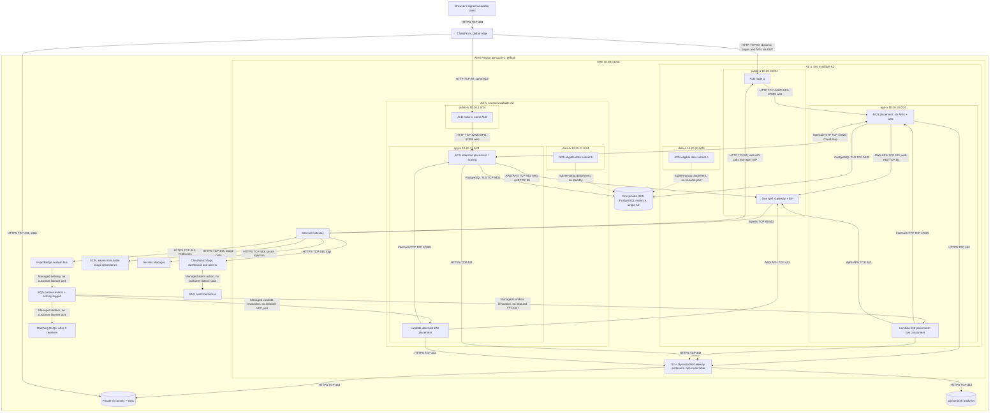

# AWS network architecture

The [editable draw.io XML](network-architecture.drawio) uses the diagrams.net AWS 2019
`mxgraph.aws4` shape family. Open it with **File > Open from > Device** in diagrams.net,
enable the AWS 2019 library if requested, and export `network-architecture.png` beside it.
The PNG and deployment screenshots are owner-produced evidence. This Mermaid diagram is the

## Boundaries and routing

- CloudFront is global, outside both the VPC and regional boundary. S3, EventBridge, SQS,
  DynamoDB, ECR, Secrets Manager, CloudWatch and SNS are managed services outside the VPC.
  Lambda execution environments are AWS-managed; the diagram places their VPC ENIs in the
  app subnets, not a public Lambda listener. SQS polling/invocation is an AWS-managed path.
  are topology labels, not promises of particular account AZ mappings. ALB spans both public
  subnets. Seven ECS services each start with one task and can scale to three; the paired
  ECS/Lambda symbols show eligible placement, not duplicate deployments per AZ.
- RDS is one `db.t4g.micro` PostgreSQL 16 instance, not a Multi-AZ pair. Its subnet group spans
  data-a and data-b and AWS chooses its instance placement. There is no standby in this build.
- Public route table defaults to IGW; app defaults to one NAT in public-a; data has no default
  route. S3 and DynamoDB gateway endpoints associate with the app route table only. Other AWS
  API traffic uses NAT on 443. DNS uses the VPC resolver and Cloud Map `habitloop.local`.
- ALB SG accepts TCP 80 from the CloudFront origin-facing prefix list and the NAT EIP `/32`.
  It forwards 47820 to APIs and 47809 to web. App SG admits these from ALB and 47820 from
  itself; DB SG admits 5432 from app SG only. Each tier has a NACL, with explicit stateless
  reply ports 1024-65535. Data inbound is limited to 5432 from the app CIDRs.
- `/api/*/internal` routes return 404 at listener priority 1. Service rules preserve the path,
  while the default targets web. Web server API calls use NAT to the public ALB on 80;
  backend and Lambda calls use Cloud Map directly on 47820.
- EventBridge routes PartnerEventReceived and ActivityLogged to separate queues/consumers.
  Event-normalizer writes through Activity and Integration APIs; analytics-updater writes to
  DynamoDB through the endpoint. RecommendationAccepted has no configured consumer.
- Arrows give destination TCP ports, except managed delivery/placement arrows explicitly marked
  as having no customer listener. SG replies are stateful; NACLs need ephemeral return rules.

See [deployment and screenshot checklist](../deployment/README.md) for validation against AWS,
and the [application overview](../../README.md) for consistency and security trade-offs.
